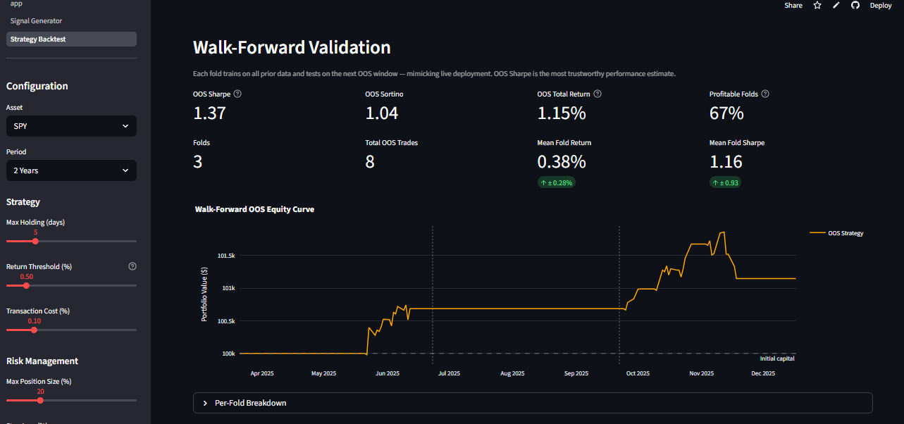

# Equity Signal Engine

[](https://github.com/craft-b/equity-signal-engine/actions/workflows/test.yml)

A production-style ML trading system demonstrating end-to-end ML engineering in finance — from raw market data to a live interactive dashboard.

## Demo



**[Live dashboard](https://equity-signal-engine-ajalyncnnkbsqpdfhkdtjd.streamlit.app)** | **[REST API](https://equity-signal-engine.onrender.com/docs)**

## Results

**SPY, 10 years (2016-08 to 2026-08), 37 walk-forward folds, 2,183 out-of-sample days.**
5-day holding, 0.5% signal threshold, 0.1% transaction cost per leg.

| | In-sample | Walk-forward (OOS) | Buy & hold |
|---|---:|---:|---:|
| Total return | 18.8% | **-0.2%** | **265.9%** |
| Sharpe | 1.01 | **0.00** | 0.87 |
| Trades | 63 | 61 | 1 |

Bootstrap Sharpe 95% CI on OOS daily returns: **[-0.67, 0.72]**
t-test on mean daily return: **t = 0.01, p = 0.99**

### There is no statistically detectable edge

The confidence interval comfortably includes zero and the strategy is beaten
by roughly 266 percentage points by doing nothing at all. This is the finding,
and it is reported rather than buried.

Three things are worth drawing out.

**The in-sample figure is meaningless, and the gap shows why.** Sharpe 1.01
in-sample against 0.00 out-of-sample is what fitting a model on the rows you
then score it on buys you. The dashboard still displays the in-sample panel,
explicitly labelled as such, because that gap is the most useful thing the
project has to teach.

**Small samples will lie to you.** On 2 years of data (4 folds, 17 trades) the
OOS Sharpe came out at 0.93 — and it *rose* when leakage was removed, which is
the wrong direction and a clear signal the sample could not resolve anything.
Only at 37 folds does the estimate settle near zero. Any backtest reporting a
Sharpe off a handful of trades is reporting noise.

**Removing label overlap halved the model's apparent skill.** With adjacent CV
folds the model scored AUC 0.674. Adding `gap=label_horizon` to
`TimeSeriesSplit` — so no training label is computed from a price inside the
test fold — drops it to **AUC 0.511, accuracy 0.499**. A coin flip. That
difference was leakage, not signal.

**Filling on the signal bar was worth the entire remaining result.** The
backtest originally read the signal at bar *i* and filled at that same bar's
close — observing a price and then trading at it. Adding a one-bar execution
lag (`BacktestConfig.execution_lag_bars`, decide at today's close, fill at
tomorrow's) moved OOS return from +1.2% to **-0.2%** and Sharpe from 0.07 to
**0.00**. Set it to 0 to reproduce the optimistic version.

The February–March 2020 fold is the worst single window: -3.9% across 15
trades as the model traded actively into the COVID drawdown. Regime-conditional
performance is broken out in the dashboard.

### Reproducing it

```bash
python scripts/measure_oos.py SPY 10y
```

Prints the table above plus per-fold detail, the bootstrap CI and the
significance test. Numbers move slightly between runs as the data window rolls
forward; the conclusion does not.

### What would have to change to find an edge

Daily OHLCV technical indicators on a single liquid index ETF is close to the
least promising place to look — that information is in the price within
milliseconds. A serious attempt would need an orthogonal data source
(fundamentals, positioning, order flow), a cross-sectional universe rather than
one ticker, and a holding period matched to the horizon at which the signal
actually decays. The engineering here would support that; the features do not.


## Quickstart

```bash
git clone https://github.com/craft-b/equity-signal-engine.git
cd equity-signal-engine
pip install -r requirements.txt        # app only
# pip install -r requirements-dev.txt  # includes jupyter + pytest
streamlit run stock_dashboard/app.py
```

## Overview

This project builds a supervised learning pipeline for short-term equity direction prediction, backed by a realistic event-driven backtest engine. The goal is to showcase ML engineering patterns applicable to systematic trading infrastructure.

**Capabilities:**
- Sklearn-compatible data pipeline with configurable technical indicator computation, outlier capping, missing-data handling, and feature selection
- Binary classifier (Random Forest or Logistic Regression) trained with proper time-series cross-validation (no look-ahead)
- Event-driven backtest engine with position sizing, stop-loss/take-profit, transaction costs, and long/short support (NumPy-vectorized loop, 4–9x faster than naive pandas iteration)
- Walk-forward OOS validation with per-fold breakdown and overfitting detector
- Bootstrap Sharpe 95% CI (1 000 resamples) and t-test for mean return significance
- Volatility regime detection (rolling percentile) with per-regime trade performance breakdown
- Multi-page Streamlit dashboard for interactive strategy exploration
- FastAPI REST service (`POST /predict`, `POST /drift`) deployed on Render with auto-generated `/docs`
- Evidently AI feature drift detection with per-column KS-test results

## Project Structure

```
equity-signal-engine/
├── stock_dashboard/
│   ├── app.py                  # Streamlit entry point (landing page)
│   ├── pages/
│   │   ├── 1_Signal_Generator.py   # ML model training + signal view
│   │   └── 2_Strategy_Backtest.py  # Backtest configuration + results
│   ├── data_pipeline.py        # Data fetching + sklearn Pipeline
│   ├── models.py               # Model training + evaluation
│   ├── backtest.py             # Event-driven backtest engine (vectorized)
│   ├── walk_forward.py         # Walk-forward OOS validation engine
│   ├── stats.py                # Bootstrap Sharpe CI + significance testing
│   ├── regimes.py              # Volatility regime detection + per-regime stats
│   ├── monitoring.py           # Evidently drift detection
│   └── utils.py                # Plotly chart builders
├── api/
│   ├── main.py                 # FastAPI service (predict + drift endpoints)
│   └── schemas.py              # Pydantic request/response models
├── tests/
│   ├── test_data_pipeline.py   # 28 tests
│   ├── test_models.py          # 23 tests
│   ├── test_backtest.py        # 31 tests
│   ├── test_walk_forward.py    # 13 tests
│   ├── test_stats.py           # 18 tests
│   ├── test_regimes.py         # 21 tests
│   ├── test_benchmark.py       # 5 tests (timing + equivalence)
│   ├── test_monitoring.py      # 15 tests
│   └── test_api.py             # 17 tests
├── notebooks/
│   └── jane_trading.ipynb      # Exploratory analysis
├── .github/workflows/
│   └── test.yml                # CI: pytest on every push
├── requirements.txt
└── README.md
```

## Tests

177 tests across the full pipeline, run automatically on every push:

```bash
pytest tests/
```

## Tech Stack

| Component | Technology |
|-----------|------------|
| Data | Yahoo Finance (`yfinance`) |
| Feature engineering | `pandas`, `numpy`, custom sklearn transformers |
| ML models | `scikit-learn` (Random Forest, Logistic Regression) |
| Statistics | `scipy` (bootstrap CI, t-test) |
| Backtesting | Custom event-driven engine (NumPy-vectorized) |
| Dashboard | `streamlit`, `plotly` |
| REST API | `fastapi`, `uvicorn` (deployed on Render) |
| Drift monitoring | `evidently` |
| CI | GitHub Actions |

## Key Design Decisions

- **Embargoed validation**: the label is a forward return over `horizon` bars, so
  training rows within `horizon` of the test window would otherwise be computed from
  test-period prices. Walk-forward holds back `embargo_bars`, and CV uses
  `TimeSeriesSplit(gap=label_horizon)`
- **Preprocessing fit inside each fold**: the scaler, outlier bounds and
  correlation-based feature selection are fitted on training rows only, then applied
  to the contiguous train+test span so rolling indicators keep their trailing history
- **Price columns never scaled**: Close/Open/High/Low remain in dollar terms for backtest accuracy
- **Time-series CV**: `TimeSeriesSplit` throughout — no random shuffling of temporal data
- **Depth-constrained Random Forest**: `max_depth=5`, `min_samples_leaf=25` to resist overfitting on noisy financial data

## Disclaimer

For educational and research purposes only. Not financial advice.
