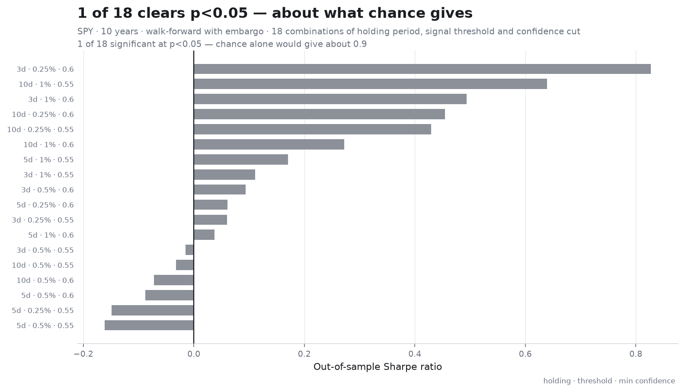

# Equity Signal Engine

[](https://github.com/craft-b/equity-signal-engine/actions/workflows/test.yml)

Walk-forward backtesting infrastructure for short-term equity direction
prediction, built to answer a question honestly rather than to answer it well.

## Demo



*Generated by `scripts/plot_results.py` from `docs/sensitivity_spy_10y.csv`, so the figure cannot drift away from the numbers.*

**[Live dashboard](https://equity-signal-engine-ajalyncnnkbsqpdfhkdtjd.streamlit.app)** | **[REST API](https://equity-signal-engine.onrender.com/docs)**

> Both run on free tiers that sleep. The dashboard may show a "wake this app"
> button and take a few minutes to rebuild; the API cold-starts in around 80
> seconds. Neither is broken — it is idle.

## The problem

Two questions sit behind this repository, and only one of them is interesting.

The first is whether daily OHLCV technical indicators can predict short-term
direction on a single liquid index ETF. The expected answer is no — that
information is in the price within milliseconds, and a decade of it is one of
the most picked-over datasets in existence. Confirming that is worth very
little.

The second is the one worth building for: **how would you know?** A backtest is
an unusually easy thing to fool yourself with, because every convenient mistake
pushes the result the same direction. Label windows that overlap the test fold
leak the answer. Filling at the close of the bar you read the signal from means
trading at a price you have only just observed. Checking stops against the
close never sees the intraday excursion that would have taken you out. Fold
boundaries are a free parameter nobody reports. And a strategy is rarely a
single configuration — it is a grid, quietly searched, with one cell written up.

Each of those, on its own, turns nothing into something. None of them announces
itself; the backtest simply returns a better number, and a better number is
exactly what you were hoping for. So the engineering problem is not building a
model. It is building the evidence chain that would let you disbelieve one —
embargoed folds, per-fold preprocessing, an execution lag, intrabar stops,
confidence intervals that respect autocorrelation, and the whole search grid
published rather than its best cell.

The strategy here has no detectable edge, which is the expected answer. What
the repository is actually for is the apparatus that establishes it, and the
part that would be reused unchanged against a dataset where the answer might be
different.

## Results

**SPY, 10 years (2016-11 to 2026-11), 37 walk-forward folds, 2,183 out-of-sample days.**
5-day holding, 0.5% signal threshold, 0.1% transaction cost per leg.

| | In-sample | Walk-forward (OOS) | Buy & hold |
|---|---:|---:|---:|
| Total return | 7.4% | **0.4%** | **237.9%** |
| Sharpe | 0.63 | **0.03** | 0.81 |
| Trades | 29 | 127 | 1 |

Stationary-bootstrap Sharpe 95% CI on OOS daily returns: **[-0.547, 0.802]**
t-test on mean daily return: **t = 0.092, p = 0.926**

Re-derived 2026-11-11 after three corrections to the pipeline, each of which
moved the numbers and none of which moved the conclusion: censored rows at the
end of each training window were being labelled 0 instead of dropped; a short
position was charged its notional twice; and a position still open at a fold
boundary was booked to cash but never counted as a trade, which is why the
out-of-sample trade count roughly doubled. The in-sample Sharpe fell from 1.29
to 0.63 on the corrected labels alone.

### There is no statistically detectable edge

The confidence interval comfortably includes zero and the strategy is beaten
by roughly 238 percentage points by doing nothing at all. This is the finding,
and it is reported rather than buried.

Three things are worth drawing out.

**The in-sample figure is meaningless, and the gap shows why.** Sharpe 0.63
in-sample against 0.03 out-of-sample is what fitting a model on the rows you
then score it on buys you. The dashboard still displays the in-sample panel,
explicitly labelled as such, because that gap is the most useful thing the
project has to teach.

**The confidence interval is built to respect autocorrelation.** Daily returns
cluster in volatility, so resampling them independently understates the spread
and can manufacture significance. `bootstrap_sharpe_ci` uses a Politis-Romano
stationary bootstrap with geometric blocks averaging `n^(1/3)` days. On an
AR(1) series the two disagree about the answer, not just the width: the IID
interval excludes zero where the stationary one includes it. Pass
`method="iid"` to see the difference.


**Small samples will lie to you.** On 2 years of data (4 folds, 17 trades) the
OOS Sharpe came out at 0.93 — and it *rose* when leakage was removed, which is
the wrong direction and a clear signal the sample could not resolve anything.
Only at 37 folds does the estimate settle near zero. The same 2-year window
today reads -0.36 on 14 trades. Any backtest reporting a Sharpe off a handful
of trades is reporting noise.

**The label-overlap embargo is correct and buys nothing measurable.** The label
is a forward return over `horizon` bars, so a training row within `horizon` of
the test window is computed partly from test-period prices. `gap=label_horizon`
on `TimeSeriesSplit` removes that overlap. Measured before the label correction,
holding everything else fixed, it moved CV AUC from **0.520 to 0.527** and accuracy
from 0.505 to 0.516 — inside the noise, and if anything upward. On the corrected
labels the classifier reads CV AUC 0.517 with the embargo in place.

That is not the result an earlier version of this section reported, which cited
a fall from 0.674 to 0.511 and called the difference leakage. That pair does not
reproduce: the same measurement against the commit that published it, on the
same data, returns 0.520 and 0.527. Rather than keep a number whose provenance
cannot be established, the honest reading is the one above — the classifier sits
at a coin flip with the embargo and without it, because there is no skill for
label overlap to inflate. The embargo stays regardless. It is correct in
principle, and its value does not depend on being able to measure a penalty for
omitting it.

**Two execution assumptions were wrong, and fixing them cost nothing
measurable.** The backtest originally read the signal at bar *i* and filled at
that same bar's close — observing a price and then trading at it. It also
checked stops against the close, which never sees an intraday excursion through
the stop that recovers by the bell. Both are corrected
(`BacktestConfig.execution_lag_bars`, `intrabar_stops`), and both corrections
are right on first principles whatever the numbers say. Holding data, model,
folds and seed constant and varying only these two settings:

| Configuration | Trades | OOS return | Sharpe | p |
|---|---:|---:|---:|---:|
| fill on the signal bar, stops on close | 115 | +0.15% | 0.02 | 0.95 |
| + one-bar execution lag | 121 | -1.75% | -0.07 | 0.84 |
| + intrabar stops (current default) | 127 | +0.40% | 0.03 | 0.93 |

Two earlier versions of this table told two different stories: first that the
lag cost the strategy its remaining return, then that it improved it. On the
corrected labels the lag lowers the figure and intrabar stops raise it back,
and the whole excursion is two points of Sharpe — less than the fold-stability
table below shows this estimator moving on nothing but where the fold
boundaries fall. That is the reading to keep: the corrections stand on their
logic, and the effect sizes were never large enough to attribute to anything.

```bash
python scripts/measure_oos.py SPY 10y --no-lag --close-stops   # first row
python scripts/measure_oos.py SPY 10y --close-stops            # second row
python scripts/measure_oos.py SPY 10y                          # current default
```

The two relaxed rows were run one trading day after the default, so their
buy-and-hold reads 236.7% against 237.9% above; the window rolled a bar.

The January–March 2020 fold is the worst single window: -6.2% across 22
trades as the model traded actively into the COVID drawdown. Regime-conditional
performance is broken out in the dashboard.

### The estimate is unstable to arbitrary choices

Where the fold boundaries fall is a free parameter, and it should not matter
much. It does:

| Min train bars | Test bars | Folds | Trades | OOS Sharpe | p |
|---:|---:|---:|---:|---:|---:|
| 300 | 63 | 35 | 123 | **+0.09** | 0.79 |
| 252 | 63 | 35 | 113 | +0.05 | 0.88 |
| 250 | 63 | 35 | 86 | +0.01 | 0.97 |
| 250 | 60 | 37 | 125 | -0.01 | 0.98 |
| 252 | 126 | 17 | 116 | -0.04 | 0.90 |
| 252 | 60 | 37 | 96 | **-0.18** | 0.61 |

Moving the minimum training window by two bars — 250 to 252, holding test bars
at 60 — moves the OOS Sharpe from -0.01 to -0.18; moving the test window by
three bars instead, 60 to 63, takes it back to +0.05 and flips the sign.
Nothing about the strategy changed. The six configurations span 0.27 of Sharpe
purely on where the folds happen to land.

Not one is significant; the smallest p-value in the set is 0.61. That is the
useful reading: the spread is noise around zero, and any single number drawn
from it would be a number about the fold boundaries rather than about the
strategy.

The instability is sharper than one table can show. Successive runs of this
same grid have returned six negative Sharpes, then three and three, then the
split above, with no change to the strategy between them beyond the
corrections noted earlier and a few months more data. A set that cannot hold
its sign between runs is not measuring the strategy, and reporting any single
cell from it — including the best one — would be reporting the sampling noise
instead.

```bash
python scripts/fold_stability.py SPY 10y     # writes docs/fold_stability_spy_10y.csv
```

Full sweep: [`docs/fold_stability_spy_10y.csv`](docs/fold_stability_spy_10y.csv), committed
alongside the sensitivity grid.

### How many configurations were tried?

The fair question about any single reported backtest. Rather than answer from
memory, the whole grid is published — 18 combinations of holding period,
signal threshold and minimum model confidence, each run through the full
walk-forward with embargo and per-fold preprocessing:

| | |
|---|---|
| OOS Sharpe across 18 configurations | min **-0.16** · median **0.08** · max **0.83** |
| Significant at p < 0.05 | **1 of 18** |
| Expected false positives at p < 0.05 | ~0.9 |

The best cell by Sharpe — 3-day holding, 0.25% threshold, 0.60 confidence —
returns 9.2% with Sharpe 0.83 on 56 trades, p = 0.016. Reported alone that
would look like a finding, and it is the one cell in the grid that clears the
5% bar. It is also exactly what a grid of eighteen is expected to produce by
chance: about 0.9 false positives, and here is the one. Its neighbours do not
support it (the same holding and threshold at 0.55 confidence reads Sharpe
0.06), and its return is a rounding error beside the buy-and-hold figure above.
Note also that it is not the best cell by *return*: that is 10-day / 0.25% /
0.55, at 11.9% and Sharpe 0.43, p = 0.21. Which configuration is "best" depends
on which column you rank by, and the two disagree — a grid with a real edge in
it would not behave that way. An earlier run of the same grid produced no
significant cell and a negative median; this one produces one and a median of
0.08. Neither is a signal.

```bash
python scripts/sensitivity.py SPY 10y     # writes docs/sensitivity_spy_10y.csv
```

Full grid: [`docs/sensitivity_spy_10y.csv`](docs/sensitivity_spy_10y.csv) — committed,
so the table and the figure above can both be checked against it. Regenerated
2026-11-11 on the pinned dependency set, after the corrections above; rerunning
moves the cells as the data window rolls forward, and has not yet moved the
conclusion.


### Reproducing it

```bash
python scripts/measure_oos.py SPY 10y
```

Prints the table above plus per-fold detail, the bootstrap CI and the
significance test. Numbers move slightly between runs as the data window rolls
forward; the conclusion does not.

### What would have to change to find an edge

Daily OHLCV technical indicators on a single liquid index ETF is close to the
least promising place to look — that information is in the price within
milliseconds. A serious attempt would need an orthogonal data source
(fundamentals, positioning, order flow), a cross-sectional universe rather than
one ticker, and a holding period matched to the horizon at which the signal
actually decays. The engineering here would support that; the features do not.


## Quickstart

```bash
git clone https://github.com/craft-b/equity-signal-engine.git
cd equity-signal-engine
pip install -r requirements.txt        # app only
# pip install -r requirements-dev.txt  # adds pytest, ruff, matplotlib
streamlit run stock_dashboard/app.py
```

## Overview

A supervised pipeline for short-term equity direction prediction, an event-driven
backtest engine, and the validation apparatus around them.

**Capabilities:**
- Sklearn-compatible data pipeline with configurable technical indicator computation, outlier capping, missing-data handling, and feature selection
- Binary classifier (Random Forest or Logistic Regression) trained with proper time-series cross-validation (no look-ahead)
- Event-driven backtest engine with position sizing, stop-loss/take-profit, transaction costs, and long/short support (NumPy-vectorized loop, 4–9x faster than naive pandas iteration)
- Walk-forward OOS validation with per-fold breakdown and overfitting detector
- Bootstrap Sharpe 95% CI (1 000 resamples) and t-test for mean return significance
- Volatility regime detection (rolling percentile) with per-regime trade performance breakdown
- Multi-page Streamlit dashboard for interactive strategy exploration
- FastAPI REST service (`POST /predict`, `POST /drift`) deployed on Render with auto-generated `/docs`.
  `/predict` serves the SMA-10/50 crossover, not the classifier: the model is retrained per
  walk-forward fold so there is no single fitted artefact to serve, and the research below
  finds no out-of-sample edge that would justify serving one
- Evidently AI feature drift detection with per-column KS-test results

## Project Structure

```
equity-signal-engine/
├── stock_dashboard/
│   ├── app.py                  # Streamlit entry point (landing page)
│   ├── pages/
│   │   ├── 1_Signal_Generator.py   # ML model training + signal view
│   │   └── 2_Strategy_Backtest.py  # Backtest configuration + results
│   ├── data_pipeline.py        # Data fetching + sklearn Pipeline
│   ├── labels.py               # Forward-return label; censored rows dropped, not labelled
│   ├── models.py               # Model training + evaluation
│   ├── backtest.py             # Event-driven backtest engine (vectorized)
│   ├── walk_forward.py         # Walk-forward OOS validation engine
│   ├── stats.py                # Bootstrap Sharpe CI + significance testing
│   ├── regimes.py              # Volatility regime detection + per-regime stats
│   ├── monitoring.py           # Evidently drift detection
│   └── utils.py                # Plotly chart builders
├── api/
│   ├── main.py                 # FastAPI service (predict + drift endpoints)
│   └── schemas.py              # Pydantic request/response models
├── tests/
│   ├── test_data_pipeline.py   # feature pipeline + transformers
│   ├── test_labels.py          # label construction + censoring
│   ├── test_models.py          # training, CV, calibration
│   ├── test_backtest.py        # execution, stops, costs, lag
│   ├── test_walk_forward.py    # folds, embargo, per-fold refit
│   ├── test_stats.py           # bootstrap CI + significance
│   ├── test_regimes.py         # volatility regime classification
│   ├── test_benchmark.py       # timing + vectorised/naive equivalence
│   ├── test_monitoring.py      # drift detection
│   ├── test_pages_importable.py# Streamlit pages parse and import
│   └── test_api.py             # REST endpoints
├── scripts/
│   ├── measure_oos.py          # in-sample vs walk-forward vs buy-and-hold, CI, t-test
│   ├── sensitivity.py          # the 18-configuration grid -> docs/sensitivity_*.csv
│   ├── fold_stability.py       # fold-boundary sweep -> docs/fold_stability_*.csv
│   └── plot_results.py         # the README figure, from the committed CSV
├── docs/                       # committed measurements the README tables are read from
├── .github/workflows/
│   └── test.yml                # CI: pytest on every push
├── requirements.txt
└── README.md
```

## Tests

212 tests across the full pipeline, run on every push against Python 3.11 and 3.12:

```bash
pytest tests/
```

## Tech Stack

| Component | Technology |
|-----------|------------|
| Data | Yahoo Finance (`yfinance`) |
| Feature engineering | `pandas`, `numpy`, custom sklearn transformers |
| ML models | `scikit-learn` (Random Forest, Logistic Regression) |
| Statistics | `scipy` (bootstrap CI, t-test) |
| Backtesting | Custom event-driven engine (NumPy-vectorized) |
| Dashboard | `streamlit`, `plotly` |
| REST API | `fastapi`, `uvicorn` (deployed on Render) |
| Drift monitoring | `evidently` |
| CI | GitHub Actions |

## Key Design Decisions

- **Embargoed validation**: the label is a forward return over `horizon` bars, so
  training rows within `horizon` of the test window would otherwise be computed from
  test-period prices. Walk-forward holds back `embargo_bars`, and CV uses
  `TimeSeriesSplit(gap=label_horizon)`
- **Preprocessing fit inside each fold**: the scaler, outlier bounds and
  correlation-based feature selection are fitted on training rows only, then applied
  to the contiguous train+test span so rolling indicators keep their trailing history
- **Censored rows are dropped, not labelled**: the last `horizon` rows of any window have
  no observable outcome. `labels.add_target` removes them before the label is formed;
  an earlier version labelled them 0, which put fabricated negatives directly against
  every test fold
- **Gaps are filled forward only**: a backward fill writes a later bar into an earlier row.
  Leading rows with no indicator history stay NaN and are zero-filled at the end
- **Price columns never scaled**: Close/Open/High/Low remain in dollar terms for backtest accuracy
- **Time-series CV**: `TimeSeriesSplit` throughout — no random shuffling of temporal data
- **Depth-constrained Random Forest**: `max_depth=5`, `min_samples_leaf=25` to resist overfitting on noisy financial data

## Disclaimer

For educational and research purposes only. Not financial advice.
